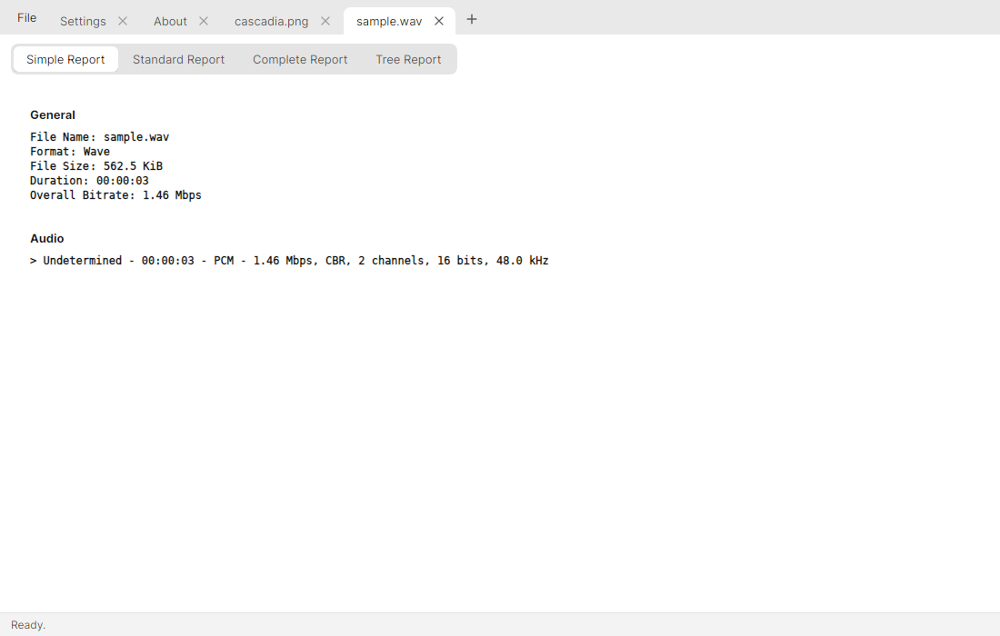
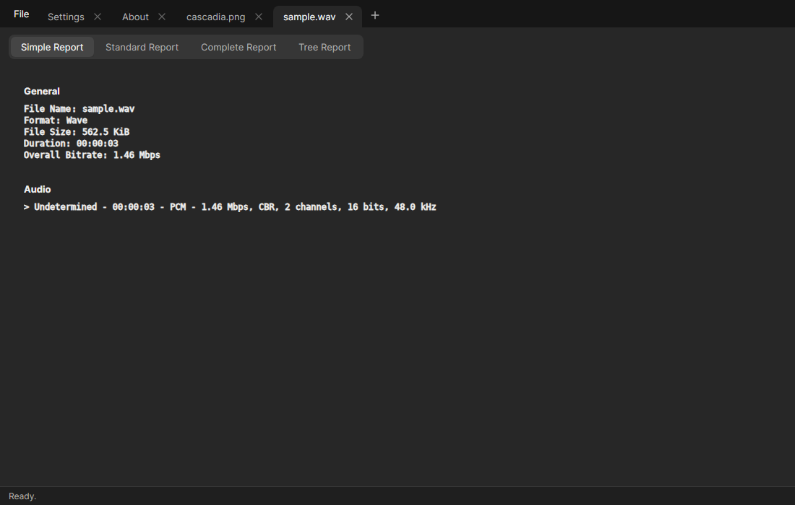
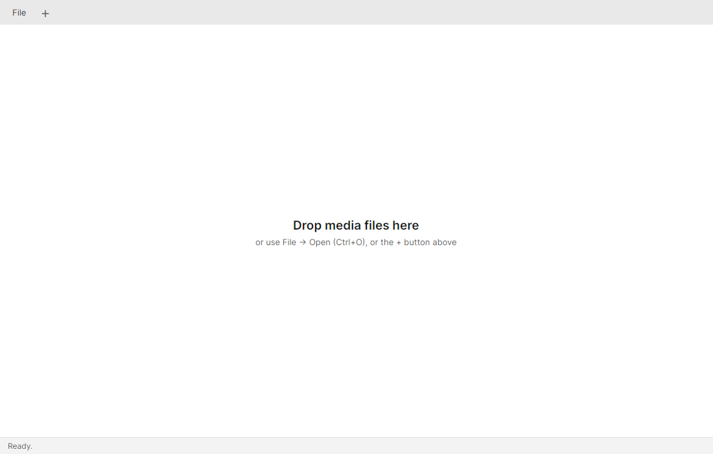
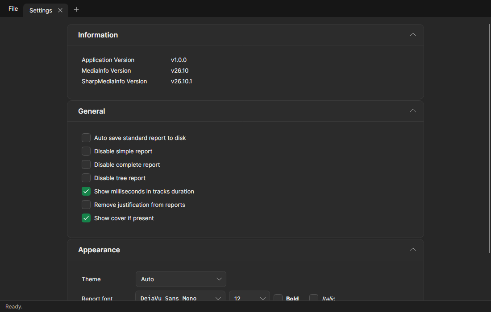

# SharpMediaInfo

[](https://github.com/simonebortolin/SharpMediaInfo/actions/workflows/ci.yml)
[](https://www.nuget.org/packages/SharpMediaInfo)
[](https://www.nuget.org/packages/SharpMediaInfo.Native)
[](https://www.nuget.org/packages/SharpMediaInfo)
[](https://github.com/simonebortolin/SharpMediaInfo/releases/latest)
[](https://github.com/MediaArea/MediaInfoLib/releases/tag/v26.10)
[](LICENSE)
[](https://dotnet.microsoft.com/)
[](#how-the-native-build-works)
[](https://avaloniaui.net/)

Cross-platform **.NET bindings and GUIs for [MediaInfo](https://mediaarea.net/MediaInfo)**, with the
native library **built from source** (no runtime downloads), strongly-typed tracks generated at
compile time, and desktop apps for Windows (WPF) and every platform (Avalonia).

Repository: <https://github.com/simonebortolin/SharpMediaInfo>

---

## Highlights

- 🧩 **Native built from source** — `mediainfo.dll` / `libmediainfo.so` / `libmediainfo.dylib` are
  compiled per RID from the pinned **MediaInfoLib** submodule (ZenLib statically bundled), so there
  is no download step and the exact sources are reproducible.
- 🪢 **Modern interop** — the P/Invoke layer uses `[LibraryImport]` and marshals strings correctly on
  every OS (UTF‑16 wide API on Windows, UTF‑8 narrow API on Linux/macOS where `wchar_t` is 4 bytes).
- 🏗️ **Source generators** — track classes are generated from MediaInfoLib's own CSV parameter
  definitions (taken straight from the submodule), with JSON overrides for naming and typing.
- 🖥️ **Two GUIs** — WPF (Windows, Fluent) and Avalonia (Windows/Linux/macOS, [Avalonia Cascadia Theme](https://github.com/simonebortolin/CascadiaUI) with Windows Terminal-style tabs in the title bar), sharing one MVVM core.
- ✅ **Tested** — unit + integration tests with [TUnit]; CI builds, tests and packs on
  Windows, Linux and macOS.
- 🎯 **.NET 10** everywhere (the Roslyn source generator targets `netstandard2.0`), with the target
  framework centralized in a single `Directory.Build.props` property.

---

## Screenshots

The Avalonia GUI with the [Avalonia Cascadia Theme](https://github.com/simonebortolin/CascadiaUI): one tab per file in the title bar, the report views as segmented tabs.

| Light | Dark |
| --- | --- |
|  |  |
|  |  |

## Project layout

| Project | Description | TFM |
| --- | --- | --- |
| `SharpMediaInfo.Native` | Native build + P/Invoke (`[LibraryImport]`) | net10.0 |
| `SharpMediaInfo` | Immutable model, `MediaInfoBuilder`, typed tracks & value types | net10.0 |
| `SharpMediaInfo.Generator` | Incremental source generator (CSV → tracks) | netstandard2.0 |
| `SharpMediaInfo.GUI` | Shared MVVM (ViewModels, services) | net10.0 |
| `SharpMediaInfo.GUI.WPF` | WPF desktop app (Windows) | net10.0-windows |
| `SharpMediaInfo.GUI.Avalonia` | Avalonia desktop app (cross-platform) | net10.0 / net10.0-windows |
| `SharpMediaInfo.*.Tests` | TUnit test suites | net10.0 |
| `extern/MediaInfoLib`, `extern/ZenLib`, `extern/zlib` | Pinned native sources (submodules) | — |

---

## Getting started

### Prerequisites

- **.NET 10 SDK**
- To build the **native** library (done automatically on first build, per host RID):
  - **Windows**: Visual Studio with the *Desktop development with C++* workload (the build retargets
    to whatever MSVC toolset is installed).
  - **Linux/macOS**: `cmake` and a C++ toolchain (`build-essential` / Xcode CLT), plus `zlib` headers.
  - **Windows → Linux**: a WSL distro with `build-essential cmake` (the build drives it automatically).

### Clone (with submodules)

```bash
git clone --recurse-submodules https://github.com/simonebortolin/SharpMediaInfo.git
# or, in an existing clone:
git submodule update --init --recursive
```

### Build

```bash
dotnet build
```

The first build compiles the native library for your current RID from the submodule and caches it
under `SharpMediaInfo.Native/native/<rid>/`; later builds are instant. To (re)build the Linux native
from Windows via WSL:

```bash
dotnet msbuild SharpMediaInfo.Native -t:BuildNativeLinux
```

### Run the tests

The test projects use [TUnit] (Microsoft.Testing.Platform), so run them with `dotnet run`:

```bash
dotnet run --project SharpMediaInfo.Tests
dotnet run --project SharpMediaInfo.Native.Tests
dotnet run --project SharpMediaInfo.GUI.Tests
```

### Run the apps

```bash
# WPF (Windows)
dotnet run --project SharpMediaInfo.GUI.WPF

# Avalonia (Windows / Linux / macOS)
dotnet run --project SharpMediaInfo.GUI.Avalonia -f net10.0
```

---

## Library usage

```csharp
using SharpMediaInfo;

var media = MediaInfoBuilder.FromFile("movie.mkv")
    .WithReports()
    .Build();

Console.WriteLine($"Format : {media.General[0].Format}");
Console.WriteLine($"Video  : {media.VideoCount} track(s), Audio: {media.AudioCount} track(s)");
if (media.Video.Count > 0)
    Console.WriteLine($"Codec  : {media.Video[0].Format}");

// Static library information
Console.WriteLine(MediaInfo.LibraryVersion()); // "MediaInfoLib - v26.10"
```

A stream can be analyzed the same way with `MediaInfoBuilder.FromStream(stream)`.

---

## How the native build works

`SharpMediaInfo.Native` never downloads binaries. On build it runs
`SharpMediaInfo.Native/build/build-native.ps1` (Windows) or `build-native.sh` (Linux/macOS), which
compile MediaInfoLib from the submodule and drop a single self-contained shared library into
`native/<rid>/`. The MSBuild targets then copy it to `runtimes/<rid>/native/` and the DLL-import
resolver loads it at runtime. CI builds every RID on its own runner (macOS: one universal build
split into `osx-arm64` and `osx-x64`), caches each native by the pinned submodule commits, and
assembles the full NuGet package.

Every release on `master` (and every pull request, as a `pr-<N>-…` pre-release that is replaced on
each push and deleted when the PR closes) ships the NuGet packages plus self-contained desktop apps:
Avalonia for `win-x64`, `linux-x64`, `linux-arm64`, `osx-arm64` and `osx-x64`, and WPF for `win-x64`.
Dependabot keeps the GitHub Actions current and Renovate the NuGet dependencies.

| RID | Toolchain |
| --- | --- |
| `win-x64`, `win-x86`, `win-arm64` | MSVC solution (`.sln`/`.slnx`) |
| `linux-x64`, `linux-arm64` | CMake (ZenLib bundled, system zlib) |
| `osx-x64`, `osx-arm64` | CMake (ZenLib bundled; `build-native.sh osx` builds both from one universal pass) |

Versions are pinned in `Directory.Build.props` (`MediaInfoVersion`, `LibZenVersion`); bumping them
means updating the submodules to the matching tags. ZenLib has no release after v0.4.41, so it is
pinned to the `master` commit current at the MediaInfoLib release (the MSVC2026 solution needs its
`Project/MSVC2026` projects). The release version is `VersionPrefix` in
`BuildVersion.props`: bump it and merging to `master` tags and publishes `vX.Y.Z`.

The **MediaInfo Bump** workflow (`.github/workflows/mediainfo-bump.yml`) does this automatically
once a month: when MediaInfoLib has a newer `vYY.MM` release it opens a pull request that moves both
submodules, `MediaInfoVersion`, `VersionPrefix` (`YY.M.0`) and the README, and starts CI on it.
Run it by hand from *Actions → MediaInfo Bump → Run workflow* (tick *dry run* to only see the diff).

---

## Technology

- **MediaInfoLib** (native, MIT) built from source with ZenLib and zlib
- **CommunityToolkit.Mvvm** — source-generated MVVM
- **Avalonia UI** — cross-platform UI
- **Polly** — resilient single-instance IPC
- **TUnit** + **Verify** — testing and snapshot testing

## License

MIT. MediaInfoLib and ZenLib are © MediaArea.net and distributed under their own (BSD-style) licenses.

[TUnit]: https://github.com/thomhurst/TUnit
